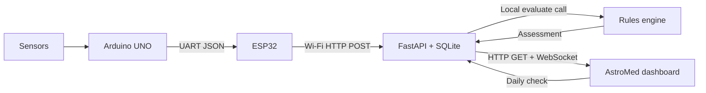

# AstroMed · Team Antares · NASA Space Apps 2026

An astronaut health monitoring prototype that brings sensor readings, guided daily checks, and explainable risk assessments together in one dashboard.

## About

AstroMed is developed by **Team Antares** for the NASA Space Apps 2026 challenge, *Create Health Monitoring Software for Astronauts on Space Missions*.

When medical support from Earth is delayed or unavailable, astronauts need a clear view of their condition and practical next steps. AstroMed connects an Arduino UNO and ESP32 sensor station to a web application that guides daily checks, explains risk alerts, and records exercise with physical sensors. Its goal is to support crew autonomy through understandable information and guidance.

This is the final hackathon version. The `main` branch contains the integrated application, firmware, simulator, and hardware design.

## What it does

- Collects crew and cabin telemetry, RFID check-ins, inactivity events, and exercise repetitions.
- Guides manual checks for blood pressure, fasting glucose, and mood.
- Evaluates four systems: cardiovascular, neurobehavioral, musculoskeletal, and cabin environment.
- Displays live readings, a clickable body view, explanations, recommendations, and trendlines with their measured data points.
- Prepares a summary for medical support on Earth when the overall risk reaches red.
- Includes firmware, a configurable two-ESP32 simulator, and KiCad schematic, PCB, BOM, and fabrication files.

## Run the API and web application

Use **Python 3.11 or later**. From the repository root, create a virtual environment:

```bash
python -m venv .venv
```

Activate it on macOS or Linux:

```bash
source .venv/bin/activate
```

On Windows PowerShell:

```powershell
.\.venv\Scripts\Activate.ps1
```

Install the dependencies and start the application:

```bash
python -m pip install -r requirements.txt
python -m uvicorn api.main:app --env-file .env.example --host 0.0.0.0 --port 8000
```

Open the [landing page](http://localhost:8000) or the [crew console](http://localhost:8000/console.html). The API also serves the frontend files, so no separate web server or frontend build is required. To connect from another device on the same network, replace `localhost` with the computer's local IP address.

The supplied [`.env.example`](.env.example) enables `ASTROMED_DEMO=1`, which triggers the inactivity alert after 30 seconds, matching the current firmware. Copy its settings to `.env` and start with `--env-file .env` to customize them.

Configuration uses `ASTROMED_API_KEY`, `ASTROMED_CORS_ORIGINS`, and the optional `ASTROMED_DATABASE_URL`. Legacy `SPACEHEALTH_*` names and an existing `spacehealth.db` are still honored; see [`api/README.md`](api/README.md) for details.

The default API key and the CORS `*` setting in `.env.example` are demo settings only; see the security notes in [`api/README.md`](api/README.md) before exposing the API beyond a trusted network.

The ESP32 must use the same API key as the backend and the computer's address in `API_BASE`. GET requests and the dashboard's manual check endpoint do not require an API key. See the [firmware setup and wiring guide](firmware/README.md) for the physical device.

## Try it with the simulator

With the API running, open another terminal, activate the virtual environment, and run:

```bash
python -m simulator.simulate
```

The simulator represents **two ESP32 devices, one per crew member**. Configure each crew member's target level in [`simulator/config.json`](simulator/config.json), or override it from the command line:

```bash
python -m simulator.simulate --level F3786E09=1 --level 336F8312=3
python -m simulator.simulate --mode normal
```

Manual checks are entered through the console's *Daily check* view. The simulator sends the same message format as the physical station; the API and risk engine calculate the assessments and trendlines. See the [simulator guide](simulator/README.md) for configuration and operating modes.

On Windows, after creating the virtual environment, [`start-demo.bat`](start-demo.bat) starts the API and simulator in separate windows.

## How it works



The physical station and simulator send telemetry every **2 seconds**. The API preserves the original UTC timestamps, handles duplicate retries, stores the messages in SQLite, and calls the risk engine in the same Python process.

The engine uses configurable, explainable rules in [`risk/thresholds.json`](risk/thresholds.json). It assigns levels from **0 (green)** to **3 (red)**, with a reason for each alert. Missing readings remain `null`: they mean **no data**, never a normal measurement.

The console follows RFID check-ins, allows manual crew selection, and shows the readings, system status, actions, and trendlines returned by the engine. The Earth summary is prepared for review and copying; it is not automatically sent to an external service.

## Repository structure

| Directory | Contents | Owner |
|---|---|---|
| `contracts/` | JSON examples and shared Pydantic models | Team Antares |
| `firmware/` | Arduino UNO sensor acquisition and ESP32 Wi-Fi gateway | Electronics lead |
| `hardware/` | KiCad schematic, PCB layout, fabrication files, and BOM | Team Antares |
| `risk/` | Risk engine and `thresholds.json` | Arsenii |
| `simulator/` | Two simulated ESP32 devices with configurable levels | Arsenii |
| `api/` | FastAPI endpoints, SQLite persistence, and WebSocket | Jesus |
| `frontend/web/` | AstroMed console, clickable body, daily checks, and charts | Roberto |

## Data contracts

| Contract | Flow | Interface | Owner |
|---|---|---|---|
| ① | Telemetry and events: ESP32 → API | `POST /api/v1/telemetry`, `POST /api/v1/events` | Electronics lead |
| ② | Manual check: frontend → API | `POST /api/v1/checks` | Roberto |
| ③ | Risk assessment: engine → API | `evaluate(...)` | Arsenii |
| ④ | Latest state and live updates: API → frontend | `GET /api/v1/crew/{crew_id}/latest`, WebSocket | Jesus |

All dates use UTC in ISO 8601 format. The API imports the engine directly:

```python
from datetime import datetime, timezone
from risk import evaluate

assessment = evaluate(
    telemetry=telemetry_messages,
    events=event_messages,
    manual_checks=manual_check_messages,
    now=datetime.now(timezone.utc),
)
```

Each input is a list of JSON message dictionaries for a **single `crew_id`**. The engine returns the assessment described in [`contracts/assessment.example.json`](contracts/assessment.example.json). Crew names and roles are provided by the API or frontend.

The API supplies telemetry from the last minute and events and manual checks from the last seven days. See the [risk engine guide](risk/README.md) for evaluation rules and trendlines, the [contract definitions](contracts/README.md) for message formats, and the [API guide](api/README.md) for endpoints.

## Run the checks

Install the development dependencies and run the Python suite:

```bash
python -m pip install -r requirements-dev.txt
python -m pytest -q
```

Frontend tests require **Node.js 20 or later**, with no additional packages:

```bash
node --test frontend/web/tests/*.test.js
```

## Final version and contributions

Use [`main`](https://github.com/arsenii-g/AntaresAstroMed/tree/main) for the final Team Antares submission. Historical feature branches are retained as development history; the integrated console served by the API is in `frontend/web/`.

For future changes, open a pull request against `main`. Changes to a data contract should be reviewed by both the producer and consumer of that data.

## Credits

AstroMed builds on the following third-party software, data, and standards.

- **Backend:** [FastAPI](https://fastapi.tiangolo.com/), [Uvicorn](https://www.uvicorn.org/), [SQLAlchemy](https://www.sqlalchemy.org/), and [Pydantic](https://docs.pydantic.dev/) (see `requirements.txt`). Tests use [pytest](https://pytest.org/) and [HTTPX](https://www.python-httpx.org/).
- **Firmware:** the Arduino and ESP32 cores, the [MFRC522](https://github.com/miguelbalboa/rfid) library for the RFID reader, and [ArduinoJson](https://arduinojson.org/).
- **Hardware design:** [KiCad](https://www.kicad.org/).
- **Frontend:** [Google Fonts](https://fonts.google.com/): Sora, Inter, and JetBrains Mono.
- **Standards and guidelines behind `risk/thresholds.json`:** NASA-STD-3001 (vols. 1 and 2), American Heart Association (AHA/ACC) blood pressure and heart rate guidance, American Diabetes Association (ADA) Standards of Care, and NOAA/NWS heat index tables.
- **Thermistor calibration:** the Steinhart-Hart coefficients in `firmware/tests/thermistor_test/` come from the Elegoo sensor kit tutorial.

## Use of AI (Super Intelligence tools)

As allowed by the NASA Space Apps rules, Team Antares used AI assistants, including Anthropic's Claude, during the hackathon. We disclose that use here.

- **Code:** AI-assisted. Parts of the API, risk engine, simulator, web console, firmware and tests were written, debugged or reviewed with AI help. The team designed the system, built and wired the hardware, and ran and checked the code against the real sensor station and the test suite.
- **Writing and translation:** AI-assisted. The documentation was drafted, edited and translated from Spanish to English with AI help.
- **Presentation and video:** AI-assisted. The motion graphics in the demo video were generated with AI-written code. The video carries a visible "SI-generated" watermark. Its footage of the breadboard and its voice-over are the team's own.
- **Hardware design files:** AI-assisted. The KiCad schematic and PCB files were prepared with AI help and checked with KiCad's electrical and design rule checks.
- **Not AI-generated:** the physical prototype, its wiring and the sensor readings recorded from it.

No NASA logos or other NASA branding were generated or modified.

## Limitations

AstroMed is an educational prototype built with a sensor kit. Its measurements are not medical-grade, and its thresholds are for demonstration rather than clinical use. Sources and assumptions are documented in `risk/thresholds.json`.

Sleep monitoring and respiration measurement are outside the current scope. The HC-SR04 is used to count push-ups. The four assessed systems are cardiovascular, neurobehavioral, musculoskeletal, and cabin environment.
