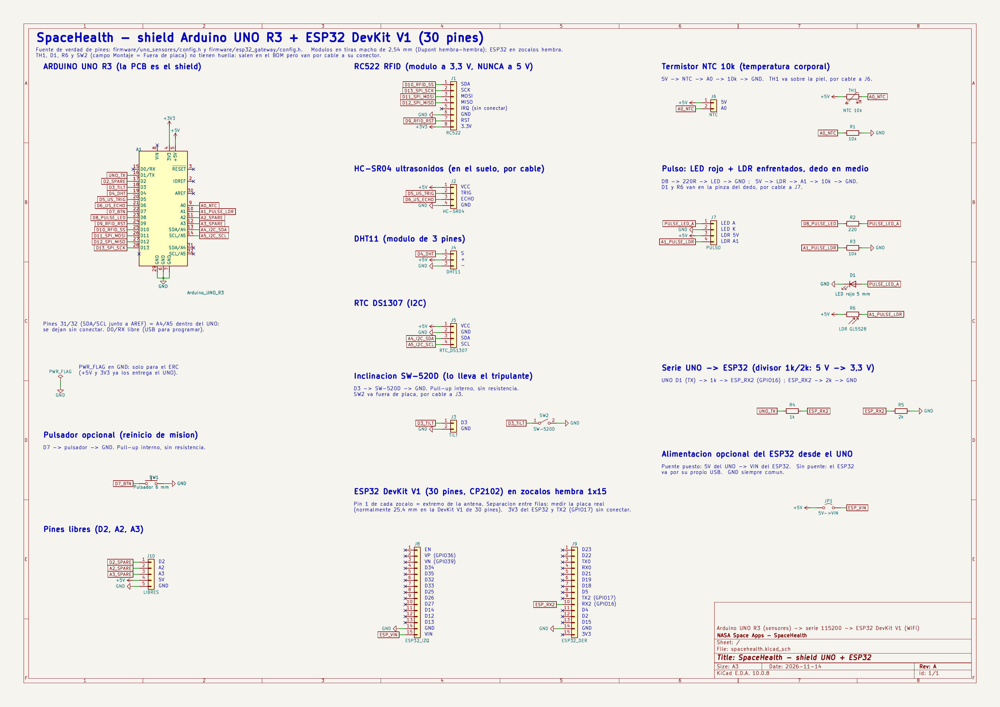

# Hardware: PCB (shield UNO + ESP32)

Esquemático del shield de SpaceHealth: una PCB que sustituye a la protoboard. Se monta encima del **Arduino UNO R3** y además lleva el **ESP32 DevKit V1 (30 pines, CP2102)** en zócalos hembra, más los conectores de todos los sensores.



Fuente de verdad de los pines: [`firmware/uno_sensores/config.h`](../firmware/uno_sensores/config.h), [`firmware/esp32_gateway/config.h`](../firmware/esp32_gateway/config.h) y [`firmware/README.md`](../firmware/README.md) (secciones «Conexiones del Arduino UNO» y «UNO → ESP32»). **Si la PCB cambia algún pin, hay que cambiarlo también en `config.h` y avisar al electrónico.**
No aparecen el PIR, los sensores de sueño ni el uso del HC-SR04 para la respiración, porque se quitaron del proyecto.

## Archivos

| Archivo | Qué es |
|---|---|
| `esquematico.pdf` | Esquemático en PDF (A3), para verlo sin instalar nada |
| `esquematico.png` | El mismo esquemático como imagen (200 ppp) |
| `bom.csv` | Lista de materiales que genera KiCad |
| `spacehealth/spacehealth.kicad_pro` | Proyecto de KiCad (abrir este) |
| `spacehealth/spacehealth.kicad_sch` | Esquemático (formato de KiCad 10) |
| `spacehealth/spacehealth.net` | Netlist (KiCad S-expr) |
| `spacehealth/erc.rpt` | Informe del ERC (0 errores, 0 avisos) |
| `gerbers/` | **Pendiente:** archivos de fabricación, cuando esté hecho el layout |
| `fotos/` | **Pendiente (opcional):** fotos de la placa montada |

- **Versión de KiCad:** se generó y comprobó con KiCad **10.0.8** (el AppImage). KiCad 8 y 9 no abren archivos guardados por KiCad 10, así que todo el equipo necesita KiCad 10.
- **Librerías:** solo se usan las librerías oficiales de KiCad (`Device`, `Connector_Generic`, `MCU_Module`, `Switch`, `Jumper`, `power`), así que no hace falta instalar nada más. Los símbolos van también incrustados en el `.kicad_sch`.
- **Pasar a PCB:** abre el proyecto, abre el editor de PCB y usa *Herramientas → Actualizar PCB desde el esquemático* (F8). Todas las huellas existen en las librerías estándar y se han comprobado cargándolas con `pcbnew`.

## Decisiones de diseño

- **Es un shield:** la huella de `A1` es `Module:Arduino_UNO_R3_WithMountingHoles`, que ya trae el contorno del UNO, los cuatro taladros y las tiras de pines en su sitio. Para el shield, suelda tiras macho largas (o *stackable*) en esas posiciones.
- **Los módulos van en tiras macho de 2,54 mm:** RC522, HC-SR04, DHT11 y RTC se conectan con cables Dupont hembra-hembra. Si quieres pinchar algún módulo directamente, cambia su huella `PinHeader_1xNN` por `PinSocket_1xNN`, que es igual de tamaño.
- **El ESP32 va en dos zócalos hembra 1x15 (`J8`, `J9`):** KiCad no trae un símbolo de la DevKit V1. El pin 1 de cada zócalo está en el extremo de la antena. **Mide la separación entre filas en tu placa** antes de colocar los zócalos en la PCB: suele ser 25,4 mm en la versión de 30 pines, pero hay clones con 22,86 mm.
- **El pulso (LED + LDR) va por conector (`J7`, 4 pines):** el LED y la LDR tienen que quedar enfrentados con el dedo en medio, así que van en una pinza o dedal fuera de la placa. La resistencia de 220 Ω y la de 10 kΩ sí van en la PCB.
- **Hay piezas fuera de placa:** `TH1` (NTC), `D1` (LED), `R6` (LDR) y `SW2` (inclinación) están dibujados en el esquema para que se vea el circuito completo y salen en el BOM. Llevan `on_board = no` (campo *Montaje = Fuera de placa*), así que no tienen huella ni pasan a la PCB. Cada una se conecta por cable a su conector.
- **El pulsador `SW1`** va soldado en la placa (pulsador de 6 mm). Es opcional: si no lo montas, no pasa nada.
- **Los pines libres D2, A2 y A3** salen a la tira `J10`, junto con 5V y GND.

## Conexiones

### Arduino UNO (pines usados)

| Pin UNO | Red (etiqueta) | Va a |
|---|---|---|
| D1 (TX) | `UNO_TX` | R4 1 kΩ → `ESP_RX2` (divisor hacia el ESP32) |
| D2 | `D2_SPARE` | J10-1 (libre) |
| D3 | `D3_TILT` | J3-1 → interruptor de inclinación SW-520D → GND (pull-up interno) |
| D4 | `D4_DHT` | J4-1 (S del DHT11) |
| D5 | `D5_US_TRIG` | J2-2 (TRIG del HC-SR04) |
| D6 | `D6_US_ECHO` | J2-3 (ECHO del HC-SR04) |
| D7 | `D7_BTN` | SW1 → GND (pull-up interno) |
| D8 | `D8_PULSE_LED` | R2 220 Ω → `PULSE_LED_A` → J7-1 (ánodo del LED) |
| D9 | `D9_RFID_RST` | J1-7 (RST del RC522) |
| D10 | `D10_RFID_SS` | J1-1 (SDA/SS del RC522) |
| D11 | `D11_SPI_MOSI` | J1-3 (MOSI) |
| D12 | `D12_SPI_MISO` | J1-4 (MISO) |
| D13 | `D13_SPI_SCK` | J1-2 (SCK) |
| A0 | `A0_NTC` | J6-2 (NTC hacia 5V) y R1 10 kΩ hacia GND |
| A1 | `A1_PULSE_LDR` | J7-4 (LDR hacia 5V) y R3 10 kΩ hacia GND |
| A2 | `A2_SPARE` | J10-2 (libre) |
| A3 | `A3_SPARE` | J10-3 (libre) |
| A4 (SDA) | `A4_I2C_SDA` | J5-3 (SDA del DS1307) |
| A5 (SCL) | `A5_I2C_SCL` | J5-4 (SCL del DS1307) |
| 5V | `+5V` | J2-1, J4-2, J5-1, J6-1, J7-3, J10-4, JP1-1 |
| 3.3V | `+3V3` | **solo** J1-8 (alimentación del RC522) |
| GND (×3) | `GND` | común a todo, incluido el ESP32 |

Sin conectar: D0/RX (lo usa el USB para programar), VIN, RESET, IOREF, AREF, y los pines SDA/SCL junto a AREF (dentro del UNO son los mismos que A4/A5).

### Conectores

| Ref. | Para | Pin 1 | Pin 2 | Pin 3 | Pin 4 | Pin 5 | Pin 6 | Pin 7 | Pin 8 |
|---|---|---|---|---|---|---|---|---|---|
| J1 (1x08) | RC522 | SDA → D10 | SCK → D13 | MOSI → D11 | MISO → D12 | IRQ (sin conectar) | GND | RST → D9 | 3.3V |
| J2 (1x04) | HC-SR04 (en el suelo) | VCC 5V | TRIG → D5 | ECHO → D6 | GND | | | | |
| J3 (1x02) | SW-520D (lo lleva el tripulante) | D3 | GND | | | | | | |
| J4 (1x03) | DHT11 (módulo) | S → D4 | + 5V | − GND | | | | | |
| J5 (1x04) | RTC DS1307 | VCC 5V | GND | SDA → A4 | SCL → A5 | | | | |
| J6 (1x02) | NTC 10k (sobre la piel) | 5V | A0 | | | | | | |
| J7 (1x04) | Pinza del pulso | ánodo del LED (tras 220 Ω) | cátodo del LED (GND) | LDR a 5V | LDR a A1 | | | | |
| J10 (1x05) | Pines libres | D2 | A2 | A3 | 5V | GND | | | |
| JP1 (1x02 + puente) | Alimentación del ESP32 | 5V del UNO | VIN del ESP32 | | | | | | |

Para los pines del DHT11 y del RTC, el orden de esta tabla es el de la placa, no necesariamente el del módulo: conecta cada cable **por el nombre** del pin del módulo (los módulos de distintos fabricantes ordenan los pines de forma distinta).

### ESP32 DevKit V1 (J8 = fila izquierda, J9 = fila derecha, pin 1 en el lado de la antena)

| Pin | J8 | Conexión | J9 | Conexión |
|---|---|---|---|---|
| 1 | EN | — | D23 | — |
| 2 | VP (GPIO36) | — | D22 | — |
| 3 | VN (GPIO39) | — | TX0 | — |
| 4 | D34 | — | RX0 | — |
| 5 | D35 | — | D21 | — |
| 6 | D32 | — | D19 | — |
| 7 | D33 | — | D18 | — |
| 8 | D25 | — | D5 | — |
| 9 | D26 | — | TX2 (GPIO17) | sin conectar |
| 10 | D27 | — | **RX2 (GPIO16)** | **`ESP_RX2`** |
| 11 | D14 | — | D4 | — |
| 12 | D12 | — | D2 | — (LED azul de la placa) |
| 13 | D13 | — | D15 | — |
| 14 | **GND** | **GND común** | **GND** | **GND común** |
| 15 | **VIN** | **`ESP_VIN`** (JP1) | 3V3 | sin conectar |

### Enlace serie UNO → ESP32 (115200 baudios)

```
UNO D1 (TX) ──R4 1k──┬── ESP32 GPIO16 (RX2)     5 V × 2k/(1k+2k) = 3,33 V
                     └──R5 2k── GND
```

- El ESP32 no le responde al UNO (TX2 sin conectar).
- **JP1 puesto:** el ESP32 se alimenta con el 5V del UNO por VIN. **JP1 quitado:** el ESP32 va por su propio USB. GND es común en ambos casos.
- **Con JP1 quitado y el ESP32 apagado,** el divisor sigue metiendo unos 3,3 V en GPIO16. No se rompe nada, pero lo normal es encender las dos placas a la vez.

### Circuitos analógicos

- **Temperatura corporal:** 5V → NTC (por J6, en la **muñeca** del tripulante) → A0 → R1 10 kΩ → GND.
- **Pulso, emisor:** D8 → R2 220 Ω → LED rojo (por J7) → GND.
- **Pulso, receptor:** 5V → LDR (por J7) → A1 → R3 10 kΩ → GND.

## BOM

| Ref. | Cant. | Valor / pieza | Huella KiCad | Montaje |
|---|---|---|---|---|
| A1 | 1 | Arduino UNO R3 (la PCB es su shield) | `Module:Arduino_UNO_R3_WithMountingHoles` | tiras macho largas o *stackable* |
| — | 1 | ESP32 DevKit V1, 30 pines, CP2102 | (en J8/J9) | pinchado en los zócalos |
| J8, J9 | 2 | Zócalo hembra 1x15, 2,54 mm | `Connector_PinSocket_2.54mm:PinSocket_1x15_P2.54mm_Vertical` | en placa |
| J1 | 1 | Tira macho 1x08, 2,54 mm (RC522) | `Connector_PinHeader_2.54mm:PinHeader_1x08_P2.54mm_Vertical` | en placa |
| J2, J5, J7 | 3 | Tira macho 1x04, 2,54 mm (HC-SR04, RTC, pulso) | `Connector_PinHeader_2.54mm:PinHeader_1x04_P2.54mm_Vertical` | en placa |
| J4 | 1 | Tira macho 1x03, 2,54 mm (DHT11) | `Connector_PinHeader_2.54mm:PinHeader_1x03_P2.54mm_Vertical` | en placa |
| J3, J6 | 2 | Tira macho 1x02, 2,54 mm (inclinación, NTC) | `Connector_PinHeader_2.54mm:PinHeader_1x02_P2.54mm_Vertical` | en placa |
| J10 | 1 | Tira macho 1x05, 2,54 mm (pines libres) | `Connector_PinHeader_2.54mm:PinHeader_1x05_P2.54mm_Vertical` | en placa |
| JP1 | 1 | Tira macho 1x02 + puente (*jumper*) | `Connector_PinHeader_2.54mm:PinHeader_1x02_P2.54mm_Vertical` | en placa |
| R1, R3 | 2 | Resistencia 10 kΩ, 1/4 W | `Resistor_THT:R_Axial_DIN0207_L6.3mm_D2.5mm_P10.16mm_Horizontal` | en placa |
| R2 | 1 | Resistencia 220 Ω, 1/4 W | ídem | en placa |
| R4 | 1 | Resistencia 1 kΩ, 1/4 W | ídem | en placa |
| R5 | 1 | Resistencia 2 kΩ, 1/4 W (o 2,2 kΩ: da 3,4 V, también vale) | ídem | en placa |
| SW1 | 1 | Pulsador táctil 6×6 mm (opcional) | `Button_Switch_THT:SW_PUSH_6mm` | en placa |
| TH1 | 1 | Termistor NTC 10 kΩ | — | fuera de placa, por cable a J6 |
| D1 | 1 | LED rojo 5 mm | — | fuera de placa, por cable a J7 |
| R6 | 1 | Fotorresistencia (LDR, p. ej. GL5528) | — | fuera de placa, por cable a J7 |
| SW2 | 1 | Interruptor de inclinación SW-520D | — | fuera de placa, por cable a J3 |
| — | 1 | Módulo RC522 + tarjetas | — | por cable a J1 |
| — | 1 | Módulo HC-SR04 | — | por cable a J2 (en el suelo) |
| — | 1 | Módulo DHT11 (3 pines) | — | por cable a J4 |
| — | 1 | Módulo RTC DS1307 | — | por cable a J5 |

La versión que genera KiCad está en `bom.csv`.

## Comprobaciones hechas

- **ERC:** `kicad-cli sch erc --severity-all` da **0 errores y 0 avisos**. El único `PWR_FLAG` está en GND. +5V y 3V3 no lo necesitan, porque ya los entrega el UNO.
- **Netlist:** salen 25 redes con nombre y se comprobaron una por una con un script contra la tabla de conexiones de arriba. Todas coinciden, incluidas las piezas de fuera de placa.
- **Huellas:** todas las del netlist se cargan con `pcbnew` de KiCad 10.0.8, y el número de pads coincide con los pines de cada símbolo (el UNO tiene 32).
- **Sin probar:** no se ha hecho el layout de la PCB, no se ha comprobado la separación real entre las filas del ESP32 (mídela) y no se ha fabricado ni probado ninguna placa.

## Regenerar las salidas

Con el AppImage de KiCad (`kicad-cli` va dentro), desde `hardware/`:

```bash
kicad-cli sch erc --severity-all -o spacehealth/erc.rpt spacehealth/spacehealth.kicad_sch
kicad-cli sch export netlist -o spacehealth/spacehealth.net spacehealth/spacehealth.kicad_sch
kicad-cli sch export bom --group-by Value,Footprint -o bom.csv spacehealth/spacehealth.kicad_sch
kicad-cli sch export pdf -o esquematico.pdf spacehealth/spacehealth.kicad_sch
pdftoppm -png -r 200 -singlefile esquematico.pdf esquematico
```

Para usar `kicad-cli` desde el AppImage: `./kicad-10.0.8-x86_64.AppImage kicad-cli <argumentos>`.
