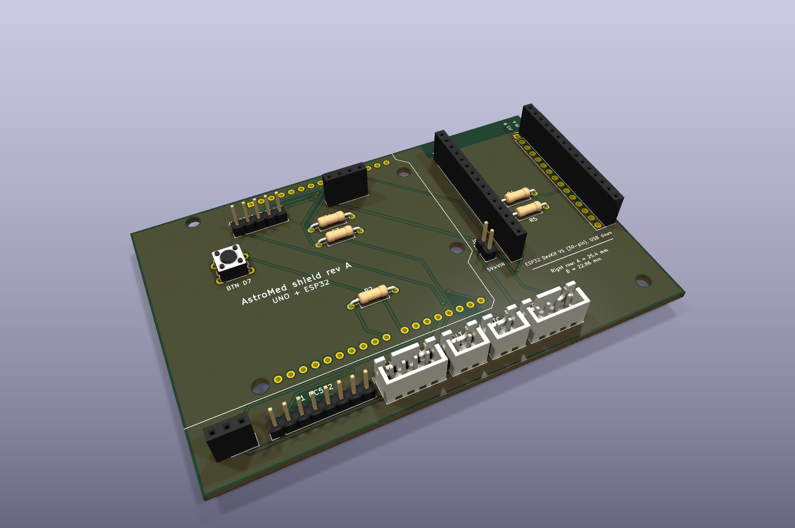
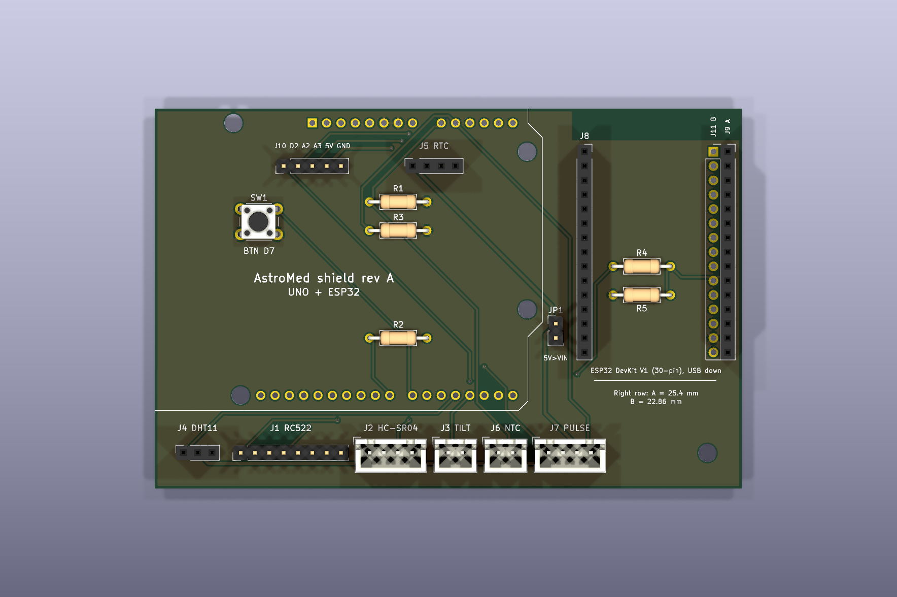
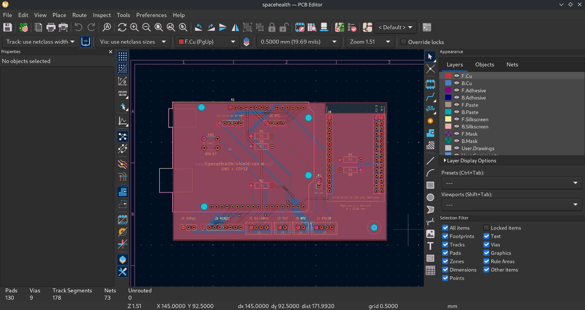
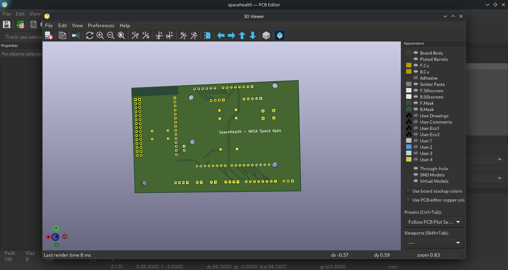

# Hardware: Arduino UNO + ESP32 shield

Schematic and PCB for the AstroMed shield, a board that replaces the breadboard prototype. It sits on top of an **Arduino UNO R3**, carries an **ESP32 DevKit V1 (30-pin, CP2102)** in female headers, and provides connectors for every sensor.




Pin assignments follow [`firmware/uno_sensores/config.h`](../firmware/uno_sensores/config.h), [`firmware/esp32_gateway/config.h`](../firmware/esp32_gateway/config.h) and [`firmware/README.md`](../firmware/README.md). Any pin change on the PCB must also be made in `config.h` and communicated to the electronics lead.

The PIR sensor, the sleep sensors and the HC-SR04 respiration measurement were removed from the project and are not part of this design.

## Files

| File | Description |
|---|---|
| `esquematico.pdf` | Schematic, A3 PDF |
| `esquematico.png` | Schematic, PNG at 200 dpi |
| `bom.csv` | Bill of materials exported from KiCad |
| `astromed/astromed.kicad_pro` | KiCad project file |
| `astromed/astromed.kicad_sch` | Schematic (KiCad 10 format) |
| `astromed/astromed.net` | Netlist (KiCad S-expression) |
| `astromed/erc.rpt` | Electrical rules check report |
| `astromed/astromed.kicad_pcb` | PCB layout |
| `astromed/astromed.kicad_dru` | Custom design rules (see [PCB](#pcb)) |
| `astromed/drc.rpt` | Design rules check report, including schematic parity |
| `pcb_top.png`, `pcb_bottom.png`, `pcb_3d.png` | 3D renders of the board |
| `kicad_pcb_editor.png`, `kicad_3d_bottom.png` | Screenshots of the KiCad PCB editor and 3D viewer (bottom side) |
| `gerbers/` | Gerber and Excellon drill files |
| `astromed_gerbers.zip` | Same files zipped, ready to upload to a PCB manufacturer |
| `fotos/` | Photos of the assembled board (optional, pending) |

- **KiCad version:** 10.0.8. Files saved by KiCad 10 cannot be opened in KiCad 8 or 9.
- **Libraries:** only the standard KiCad libraries are used (`Device`, `Connector_Generic`, `MCU_Module`, `Switch`, `Jumper`, `power`). Symbols are also embedded in the `.kicad_sch` file.
- **Schematic changes:** after editing the schematic, run *Tools → Update PCB from Schematic* (F8) in the PCB editor. Footprints are linked to their symbols, so existing placement and routing are kept.

## Design notes

- **Shield form factor.** `A1` uses the `Module:Arduino_UNO_R3_WithMountingHoles` footprint, which provides the UNO outline, mounting holes and header positions. Use stackable headers (1x10, 2x 1x8 and 1x6).
- **Sensors that move use JST-XH connectors.** The HC-SR04 (on the floor, push-ups), the tilt switch (worn by the crew member), the NTC (wrist) and the pulse finger clip connect through latching 2.5 mm JST-XH connectors (`J2`, `J3`, `J6`, `J7`), so cables do not pull out during use.
- **Static modules plug into the board.** The DHT11 (`J4`) and the DS1307 RTC (`J5`) plug into female sockets, with no cables. The RC522 (`J1`) stays on a 1x08 male header and is wired to the reader, which must sit on an accessible face of the enclosure.
- **ESP32 on 1x15 female headers, with two positions for the right row.** KiCad has no symbol for the DevKit V1. Pin 1 of each header is at the antenna end. The right row can be fitted at 25.4 mm (`J9`, row A, default) or 22.86 mm (`J11`, row B, marked DNP) from the left row (`J8`), because 30-pin DevKit V1 clones use either spacing. Measure the board and solder the socket in the matching row only.
- **Pulse sensor on a 4-pin connector (`J7`).** The LED and LDR face each other across the fingertip, so they are mounted in an external finger clip. The 220 Ω and 10 kΩ resistors are on the PCB. The firmware currently simulates the heart rate (`PULSE_SIMULATED 1`), but the circuit is kept for future use.
- **Off-board parts.** `TH1` (NTC), `D1` (LED), `R6` (LDR) and `SW2` (tilt switch) are drawn to show the complete circuit and are listed in the BOM. They are marked `on_board = no` (field *Mounting*), so they have no footprint and are not transferred to the PCB. Each one is wired to its connector.
- **Push button `SW1`.** 6 mm tactile switch mounted on the board. It is optional.
- **Spare pins.** D2, A2 and A3 are routed to header `J10` together with 5V and GND.

## Connections

### Arduino UNO

| UNO pin | Net | Connects to |
|---|---|---|
| D1 (TX) | `UNO_TX` | R4 1 kΩ to `ESP_RX2` (level divider to the ESP32) |
| D2 | `D2_SPARE` | J10-1 (spare) |
| D3 | `D3_TILT` | J3-1, SW-520D tilt switch to GND (internal pull-up) |
| D4 | `D4_DHT` | J4-1 (DHT11 data) |
| D5 | `D5_US_TRIG` | J2-2 (HC-SR04 TRIG) |
| D6 | `D6_US_ECHO` | J2-3 (HC-SR04 ECHO) |
| D7 | `D7_BTN` | SW1 to GND (internal pull-up) |
| D8 | `D8_PULSE_LED` | R2 220 Ω to `PULSE_LED_A`, J7-1 (LED anode) |
| D9 | `D9_RFID_RST` | J1-7 (RC522 RST) |
| D10 | `D10_RFID_SS` | J1-1 (RC522 SDA/SS) |
| D11 | `D11_SPI_MOSI` | J1-3 (MOSI) |
| D12 | `D12_SPI_MISO` | J1-4 (MISO) |
| D13 | `D13_SPI_SCK` | J1-2 (SCK) |
| A0 | `A0_NTC` | J6-2 (NTC to 5V), R1 10 kΩ to GND |
| A1 | `A1_PULSE_LDR` | J7-4 (LDR to 5V), R3 10 kΩ to GND |
| A2 | `A2_SPARE` | J10-2 (spare) |
| A3 | `A3_SPARE` | J10-3 (spare) |
| A4 (SDA) | `A4_I2C_SDA` | J5-3 (DS1307 SDA) |
| A5 (SCL) | `A5_I2C_SCL` | J5-4 (DS1307 SCL) |
| 5V | `+5V` | J2-1, J4-2, J5-1, J6-1, J7-3, J10-4, JP1-1 |
| 3.3V | `+3V3` | J1-8 only (RC522 supply) |
| GND (x3) | `GND` | Common ground, including the ESP32 |

Not connected: D0/RX (used by USB for programming), VIN, RESET, IOREF, AREF, and the SDA/SCL pins next to AREF (internally the same as A4/A5).

### Connectors

| Ref | Function | Pin 1 | Pin 2 | Pin 3 | Pin 4 | Pin 5 | Pin 6 | Pin 7 | Pin 8 |
|---|---|---|---|---|---|---|---|---|---|
| J1 (1x08) | RC522 | SDA (D10) | SCK (D13) | MOSI (D11) | MISO (D12) | IRQ (NC) | GND | RST (D9) | 3.3V |
| J2 (JST-XH 4) | HC-SR04 (floor, push-ups) | VCC 5V | TRIG (D5) | ECHO (D6) | GND | | | | |
| J3 (JST-XH 2) | SW-520D (worn by crew member) | D3 | GND | | | | | | |
| J4 (socket 1x03) | DHT11 module | DATA (D4) | 5V | GND | | | | | |
| J5 (socket 1x04) | DS1307 RTC | VCC 5V | GND | SDA (A4) | SCL (A5) | | | | |
| J6 (JST-XH 2) | 10k NTC (skin contact) | 5V | A0 | | | | | | |
| J7 (JST-XH 4) | Pulse finger clip | LED anode (after 220 Ω) | LED cathode (GND) | LDR to 5V | LDR to A1 | | | | |
| J10 (1x05) | Spare pins | D2 | A2 | A3 | 5V | GND | | | |
| JP1 (1x02 + jumper) | ESP32 power | UNO 5V | ESP32 VIN | | | | | | |

The DHT11 and RTC sockets follow the pin order above, which may not match every module: pinouts vary between manufacturers. Check the module before plugging it in. If the order differs, connect it with jumper wires by pin name instead.

### ESP32 DevKit V1

J8 is the left row and J9 the right row (row A, 25.4 mm), with pin 1 at the antenna end. J11 (row B, 22.86 mm) has the same pinout as J9.

| Pin | J8 | Connection | J9 | Connection |
|---|---|---|---|---|
| 1 | EN | NC | D23 | NC |
| 2 | VP (GPIO36) | NC | D22 | NC |
| 3 | VN (GPIO39) | NC | TX0 | NC |
| 4 | D34 | NC | RX0 | NC |
| 5 | D35 | NC | D21 | NC |
| 6 | D32 | NC | D19 | NC |
| 7 | D33 | NC | D18 | NC |
| 8 | D25 | NC | D5 | NC |
| 9 | D26 | NC | TX2 (GPIO17) | NC |
| 10 | D27 | NC | **RX2 (GPIO16)** | **`ESP_RX2`** |
| 11 | D14 | NC | D4 | NC |
| 12 | D12 | NC | D2 | NC (on-board blue LED) |
| 13 | D13 | NC | D15 | NC |
| 14 | **GND** | **GND** | **GND** | **GND** |
| 15 | **VIN** | **`ESP_VIN`** (JP1) | 3V3 | NC |

### UART link, UNO to ESP32 (115200 baud)

```
UNO D1 (TX) ──R4 1k──┬── ESP32 GPIO16 (RX2)     5 V × 2k/(1k+2k) = 3.33 V
                     └──R5 2k── GND
```

- The link is one-way. ESP32 TX2 is not connected.
- With JP1 fitted, the ESP32 is powered from the UNO 5V rail through VIN. With JP1 removed, the ESP32 is powered from its own USB port. Ground is shared in both cases.
- With JP1 removed and the ESP32 unpowered, the divider still applies about 3.3 V to GPIO16. This does not damage the board, but both boards should normally be powered together.

### Analog circuits

- **Body temperature:** 5V, NTC (via J6, on the crew member's wrist), A0, R1 10 kΩ, GND.
- **Pulse emitter:** D8, R2 220 Ω, red LED (via J7), GND.
- **Pulse receiver:** 5V, LDR (via J7), A1, R3 10 kΩ, GND.

## Bill of materials

| Ref | Qty | Part | KiCad footprint | Mounting |
|---|---|---|---|---|
| A1 | 1 | Arduino UNO R3 (host board) | `Module:Arduino_UNO_R3_WithMountingHoles` | Long-pin or stackable headers |
| - | 1 | ESP32 DevKit V1, 30-pin, CP2102 | (on J8/J9) | Plugged into headers |
| - | 1 set | Stackable headers for the UNO: 1x10, 2x 1x8, 1x6 | (on A1) | On board |
| J8, J9 | 2 | Female header 1x15, 2.54 mm | `Connector_PinSocket_2.54mm:PinSocket_1x15_P2.54mm_Vertical` | On board |
| J11 | - | Female header 1x15, 2.54 mm, instead of J9 for 22.86 mm boards | Same as above | DNP |
| J1 | 1 | Male header 1x08, 2.54 mm (RC522) | `Connector_PinHeader_2.54mm:PinHeader_1x08_P2.54mm_Vertical` | On board |
| J2, J7 | 2 | JST-XH B4B-XH-A, 4 pins (HC-SR04, pulse) | `Connector_JST:JST_XH_B4B-XH-A_1x04_P2.50mm_Vertical` | On board |
| J3, J6 | 2 | JST-XH B2B-XH-A, 2 pins (tilt, NTC) | `Connector_JST:JST_XH_B2B-XH-A_1x02_P2.50mm_Vertical` | On board |
| - | 2 + 2 | JST-XH housings XHP-4 and XHP-2, with SXH-001T-P0.6 crimp terminals | - | Cable side |
| J4 | 1 | Female socket 1x03, 2.54 mm (DHT11) | `Connector_PinSocket_2.54mm:PinSocket_1x03_P2.54mm_Vertical` | On board |
| J5 | 1 | Female socket 1x04, 2.54 mm (RTC) | `Connector_PinSocket_2.54mm:PinSocket_1x04_P2.54mm_Vertical` | On board |
| J10 | 1 | Male header 1x05, 2.54 mm (spare pins) | `Connector_PinHeader_2.54mm:PinHeader_1x05_P2.54mm_Vertical` | On board |
| JP1 | 1 | Male header 1x02 with jumper | `Connector_PinHeader_2.54mm:PinHeader_1x02_P2.54mm_Vertical` | On board |
| R1, R3 | 2 | Resistor 10 kΩ, 1/4 W | `Resistor_THT:R_Axial_DIN0207_L6.3mm_D2.5mm_P10.16mm_Horizontal` | On board |
| R2 | 1 | Resistor 220 Ω, 1/4 W | Same as above | On board |
| R4 | 1 | Resistor 1 kΩ, 1/4 W | Same as above | On board |
| R5 | 1 | Resistor 2 kΩ, 1/4 W (2.2 kΩ also acceptable, 3.4 V) | Same as above | On board |
| SW1 | 1 | Tactile switch 6x6 mm (optional) | `Button_Switch_THT:SW_PUSH_6mm` | On board |
| TH1 | 1 | NTC thermistor 10 kΩ | - | Off board, wired to J6 |
| D1 | 1 | Red LED 5 mm | - | Off board, wired to J7 |
| R6 | 1 | Photoresistor (LDR, e.g. GL5528) | - | Off board, wired to J7 |
| SW2 | 1 | SW-520D tilt switch | - | Off board, wired to J3 |
| - | 1 | RC522 module with cards | - | Wired to J1 |
| - | 1 | HC-SR04 module | - | Wired to J2 (floor-mounted) |
| - | 1 | DHT11 module (3-pin) | - | Plugged into J4 |
| - | 1 | DS1307 RTC module | - | Plugged into J5 |

The KiCad export is in `bom.csv`.

## PCB



| Parameter | Value |
|---|---|
| Size | 104.14 x 67.31 mm (UNO outline plus a 35.56 mm extension for the ESP32 and a 13.97 mm connector strip) |
| Layers | 2, 1.6 mm FR-4, all parts through-hole |
| Tracks | 0.3 mm signals, 0.5 mm for +5V, +3V3 and ESP_VIN |
| Clearance | 0.2 mm minimum, 0.6 mm from tracks to the board edge |
| Vias | 0.7 mm pad, 0.35 mm drill (10 in total) |
| Ground | GND pour on both layers |
| Mounting | The four UNO holes plus one M3 hole (`H1`) under the overhanging corner |

Layout:

- The UNO headers are at their standard positions on the left. The ESP32 sits on the right extension with its USB connector towards the bottom edge. Its antenna overhangs the top edge, over a copper keepout area.
- All cable connectors are in a row along the bottom edge, labelled on the silkscreen (`J4 DHT11`, `J1 RC522`, `J2 HC-SR04`, `J3 TILT`, `J6 NTC`, `J7 PULSE`). The DHT11 is in the far corner, away from the heat of the ESP32.
- The divider resistors R4 and R5 sit under the ESP32, between its two rows. With the socket height, they fit under the module.
- The UNO USB-B connector is close to the underside of the shield. Put a piece of insulating tape on top of it before stacking the boards.

`astromed.kicad_dru` adds five rules for situations that are intended in this design: shield parts inside the UNO courtyard, the overlapping J9/J11 rows and their silkscreen, the UNO outline reaching past the board edge, and GND pads with a single thermal spoke on the top layer, which are still fully connected on the bottom layer.

Screenshots from KiCad:





To order the board, upload `astromed_gerbers.zip`. Default options are fine: 2 layers, 1.6 mm, 1 oz copper, any solder mask colour.

## Verification

- **ERC:** `kicad-cli sch erc --severity-all` reports 0 errors and 0 warnings. A single `PWR_FLAG` is placed on GND; +5V and 3V3 are driven by the UNO power pins.
- **Netlist:** all 25 named nets were checked against the connection tables above, including off-board parts.
- **Footprints:** every footprint in the netlist loads in KiCad 10.0.8 `pcbnew`, and pad counts match the symbol pin counts (32 for the UNO).
- **DRC:** `kicad-cli pcb drc --schematic-parity --severity-all --refill-zones` reports 0 violations, 0 unconnected pads and 0 schematic parity errors.
- **Not yet done:** measurement of the ESP32 row spacing (choose J9 or J11), and fabrication and testing of a board.

## Regenerating outputs

From `hardware/`, with `kicad-cli` from KiCad 10:

```bash
kicad-cli sch erc --severity-all -o astromed/erc.rpt astromed/astromed.kicad_sch
kicad-cli sch export netlist -o astromed/astromed.net astromed/astromed.kicad_sch
kicad-cli sch export bom --fields 'Reference,Value,Footprint,${QUANTITY},Mounting,${DNP}' --labels 'Reference,Value,Footprint,Quantity,Mounting,DNP' --group-by Value,Footprint --ref-range-delimiter '' -o bom.csv astromed/astromed.kicad_sch
kicad-cli sch export pdf -o esquematico.pdf astromed/astromed.kicad_sch
pdftoppm -png -r 200 -singlefile esquematico.pdf esquematico
kicad-cli pcb drc --schematic-parity --severity-all --refill-zones --save-board -o astromed/drc.rpt astromed/astromed.kicad_pcb
kicad-cli pcb export gerbers --no-protel-ext -l F.Cu,B.Cu,F.Silkscreen,B.Silkscreen,F.Mask,B.Mask,Edge.Cuts -o gerbers/ astromed/astromed.kicad_pcb
kicad-cli pcb export drill --excellon-separate-th -o gerbers/ astromed/astromed.kicad_pcb
(cd gerbers && zip ../astromed_gerbers.zip *)
kicad-cli pcb render --side top --quality high -o pcb_top.png astromed/astromed.kicad_pcb
```

When using the AppImage, run `kicad-cli` as `./kicad.appimage kicad-cli <arguments>`.
